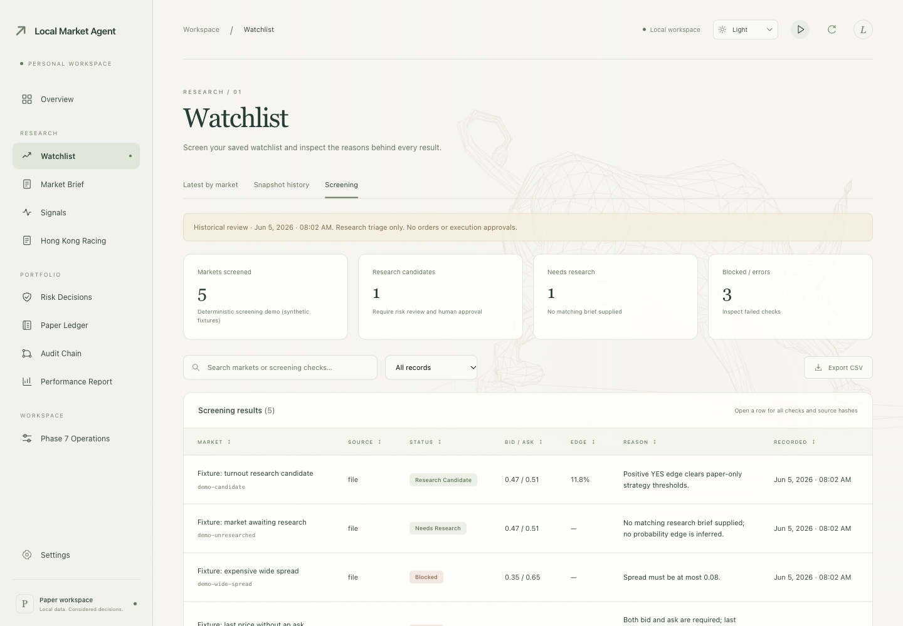
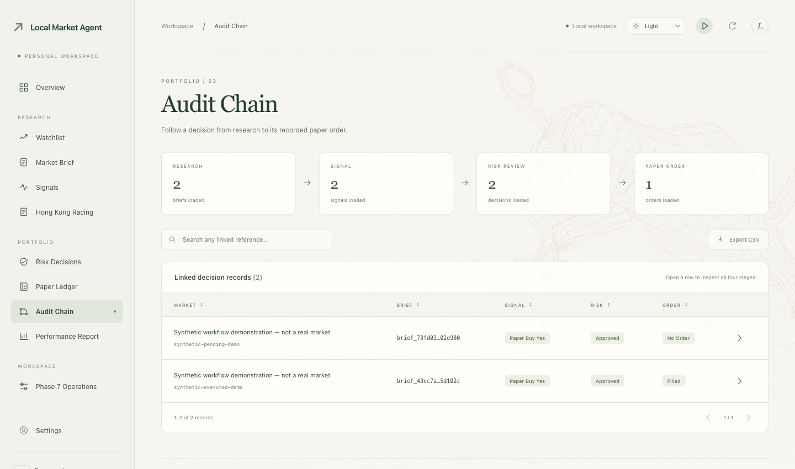

# Local Market Agent

[简体中文](docs/README.zh-CN.md) · [User guide](docs/users/README.md) · [Agent guide](docs/agents/README.md) · [Releases](https://github.com/ThineLord/local-market-agent/releases)

A local workspace for **public-market research, risk checks and paper trading**. Follow the evidence from a market snapshot through explicit approval to a simulated trade and its audit trail.

**Paper only.** No live orders. Demo results do not establish profitability.


*The actual dashboard running deterministic synthetic examples; no live quotes or private trading records.*

## Try it locally

Python **3.11+** · no API key needed for the offline demo.

```bash
python3 -m venv .venv
. .venv/bin/activate
python -m pip install -e ".[dev]"
lma watchlist-screen --as-of 2026-06-05T00:02:00Z
python ui/server.py
```

Open [Watchlist → Screening](http://127.0.0.1:8502/#watchlist/screening). The fixed date matches the demo fixtures. If the port is occupied, add `--port 8503`.

## From evidence to a paper trade

**Screen → Research → Risk review → Explicit approval → Simulated fill → Audit**

Compare markets and blocking reasons, inspect the source evidence, then approve an exact intent in the terminal. The dashboard is read-only. The [complete offline walkthrough](docs/users/README.md#approval-and-evidence-workflow) demonstrates the approval and audit trail.

<details>
<summary>See the audit trail</summary>



*Synthetic workflow only. Each record links to its supporting evidence.*

</details>

Optional research workflows: [NBA probabilities](docs/reference/NBA_PROBABILITY.md) · [Hong Kong racing replay](docs/reference/HORSE_REPLAY.md). Racing inputs with missing evidence remain UNKNOWN; racing research currently returns NO BET.

## Find your way

| Area | Contents |
| --- | --- |
| [`src/`](src/local_market_agent/) | Research, risk controls and paper ledger |
| [`ui/`](ui/) | Local dashboard |
| [`data/`](data/fixtures/) | Offline fixtures; generated data stays local |
| [`scripts/`](scripts/) | Reproducible workflows and release checks |
| [`tests/`](tests/) | Offline tests and optional network checks |
| [`docs/`](docs/README.md) | User/agent guides, technical references and release history |

Version **0.5.1** · [What's new](docs/releases/0.5.1.md) · [Changelog](docs/CHANGELOG.md)

Contributing? Start with [AGENTS.md](AGENTS.md). Codex implements; subagents review and merge. Safety defaults remain `REAL_MONEY_ENABLED=false`, `ALLOW_LIVE_ORDERS=false`, `HUMAN_APPROVAL_REQUIRED=true`.
