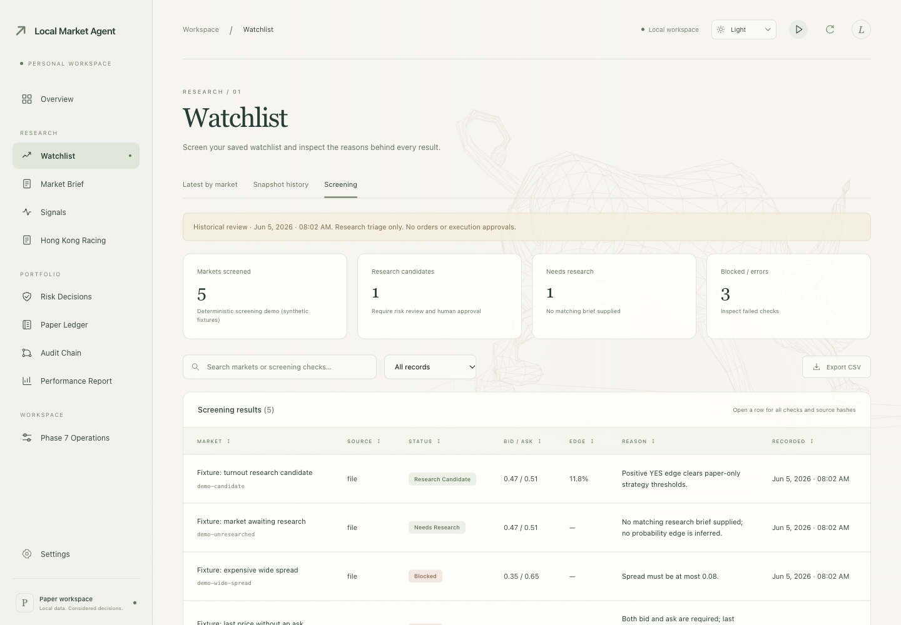
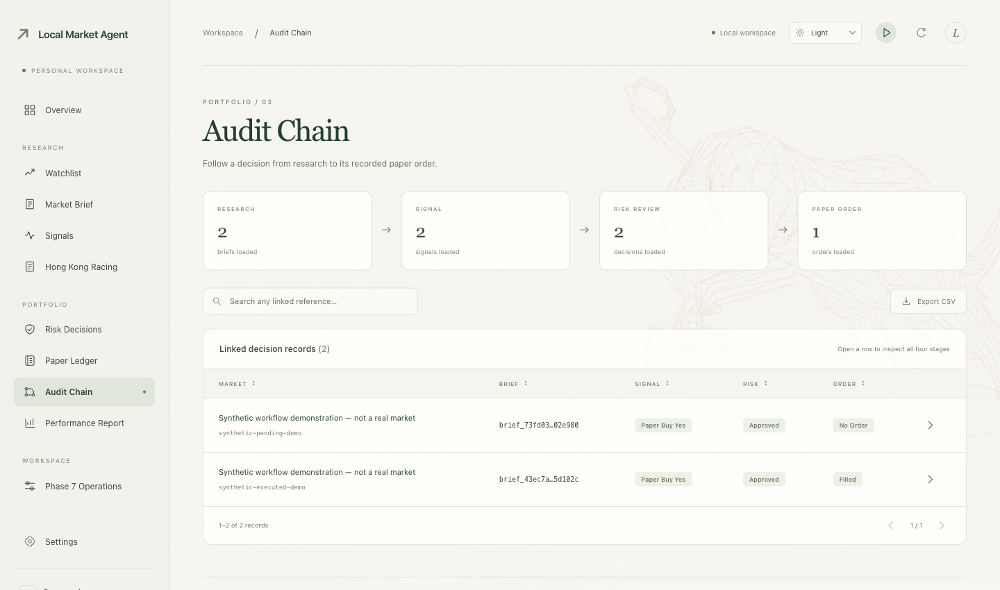

# Local Market Agent

[English](../README.md) · [用户指南](users/README.zh-CN.md) · [Agent 指南](agents/README.zh-CN.md) · [版本发布](https://github.com/ThineLord/local-market-agent/releases)

一个用于**公开市场研究、风险检查和模拟交易**的本地工作区。从市场快照出发，沿着证据、逐意图审批、模拟成交到审计记录，检查整个流程。

**仅限模拟交易，不支持实盘下单。示例结果不能证明盈利能力。**


*真实运行的界面，使用确定性合成示例；截图不包含实时行情或私人交易记录。*

## 本地启动

使用 Python **3.11+**，离线示例不需要 API 密钥。

```bash
python3 -m venv .venv
. .venv/bin/activate
python -m pip install -e ".[dev]"
lma watchlist-screen --as-of 2026-06-05T00:02:00Z
python ui/server.py
```

打开[观察列表 → 筛选](http://127.0.0.1:8502/#watchlist/screening)。固定日期对应示例数据；端口占用时添加 `--port 8503`。

## 从证据到模拟成交

**筛选 → 研究 → 风险审核 → 明确审批 → 模拟成交 → 审计**

比较市场及阻断原因，检查来源证据，再通过终端批准确切订单意图。仪表板保持只读。[完整离线演示](users/README.zh-CN.md)包含审批、成交及可追溯记录。

<details>
<summary>展开查看审计记录</summary>



*合成工作流示例；每项记录都可查看其关联证据。*

</details>

可选研究流程：[NBA 概率](reference/NBA_PROBABILITY.md) · [香港赛马回放](reference/HORSE_REPLAY.zh-CN.md)。赛马资料缺失时保留 UNKNOWN，当前赛马研究输出 NO BET。

## 文件导航

| 位置 | 用途 |
| --- | --- |
| [`src/`](../src/local_market_agent/) | 研究、风控与模拟账本 |
| [`ui/`](../ui/) | 本地仪表板 |
| [`data/`](../data/fixtures/) | 离线示例；生成数据保留本地 |
| [`scripts/`](../scripts/) | 可复现工作流与版本检查 |
| [`tests/`](../tests/) | 离线测试及可选网络检查 |
| [`docs/`](README.md) | 用户/Agent 指南、技术文档与版本历史 |

当前版本 **0.5.1** · [更新说明](releases/0.5.1.zh-CN.md) · [变更日志](CHANGELOG.md)

参与开发请先阅读 [AGENTS.md](../AGENTS.md)。Codex 实现，subagents 审查合并。安全默认值保持 `REAL_MONEY_ENABLED=false`、`ALLOW_LIVE_ORDERS=false`、`HUMAN_APPROVAL_REQUIRED=true`。
