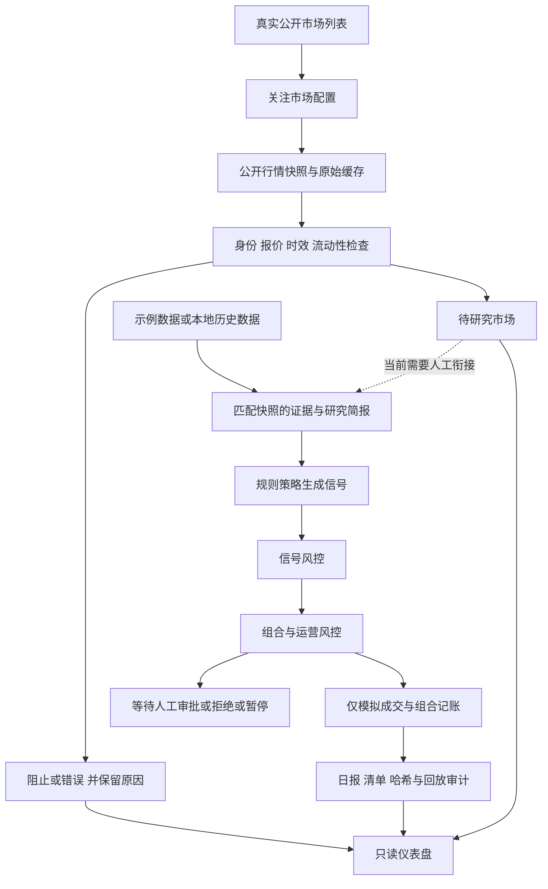

# Local Market Agent 当前全流程报告

日期：2026 年 10 月 15 日，香港时间。代码基线：`a37bb37e951f2da73eef0cfba03a3a145631df9f`。

## 当前结论

**项目已经具备可运行的离线研究与模拟交易框架，真实公开行情也已接通并完成一次九市场筛选；真实行情、独立研究、人工审批、组合风控和持续模拟运营之间仍有断点。**

目前可以用它检查行情输入、整理研究队列、验证规则、生成模拟订单和审计报告。尚不能把它当作能自动发现可靠机会并完成研究决策的系统，也没有建立盈利能力或策略优越性的证据。

| 路径 | 当前验证状态 | 能支持的结论 |
| --- | --- | --- |
| 真实行情 → 标准化 → 批量筛选 → 报告 → 页面 | 九市场实跑完成，零解析错误 | 有条件地用于报价质量初筛 |
| 示例行情和证据 → 简报 → 信号 → 风控 → 模拟记账 → 回放 | 本轮三个隔离场景验证通过 | 离线流程可以运行，默认人工门控有效 |
| 真实行情 → 独立证据 → 概率判断 → 风控 → 模拟运营 | 本轮未形成完整闭环，代码衔接仍不完整 | 不能从行情接入成功推断研究决策已经可用 |
| 历史数据 → 校准 → 策略比较 → 验收 | 有验证和评估工具；当前九市场快照不满足验收用途 | 可以做诊断，不能据此声称盈利或 Strategy v2 更优 |

## 流程总览

图中的虚线是当前需要补齐的业务衔接。关注列表筛选和日常模拟运行是两个入口；页面刷新只读取已经保存的数据。

## 数据接入与市场选择

已实现的来源包括确定性示例文件、本地历史 JSONL，以及 Polymarket、Kalshi、yfinance 的只读数据适配器。SEC EDGAR 和 GDELT 有辅助证据接口，但存在这些接口不代表它们已经接入每次研究任务。

多市场入口 `lma watchlist-screen` 接受 1 至 50 个唯一的来源与市场编号组合，支持本地快照，以及显式启用网络的 Kalshi 和 Polymarket 快照。每个市场独立记录结果，一个输入失败不会中断其余市场。原始响应保存在本地，筛选不会创建订单或打开交易数据库。

市场发现目前仍需要外部步骤生成关注列表。刚才的实跑先读取有限列表，再固定九个样本，并未证明已经具有稳定、分散、适合研究的市场选择能力：最新的 Kalshi 列表集中在零成交量的电子体育市场；Polymarket 的累计成交量排名则选出了多只缺买价的极端概率合约。

**接入已经可用，市场发现和研究优先级仍是薄弱环节。**

## 报价筛选与真实运行结果

筛选器检查市场编号、明确开市状态、YES/NO 结果顺序、可用的收盘时间、观测时间、双边报价、价差、流动性，以及市场概率是否落在买卖价之间。默认最大观测年龄为 300 秒、最大价差为 0.08、最小报告流动性为 100。

状态分为 `blocked`、`error`、`needs_research`、`observe` 和 `research_candidate`。最后一种表示现有规则产生了研究候选，仍不包含组合风控或执行授权。

2026 年 10 月 15 日 14:19，原样运行已发布代码，完成 2 次列表请求与 9 次市场详情请求，没有重试。结果为 **9 个快照解析成功、0 个逐项错误、2 个待研究、7 个被阻止、0 个研究候选和订单**。

| 样本组 | 数量 | 保存的结果 | 解释 |
| --- | --- | --- | --- |
| Kalshi 电子体育合约 | 3 | blocked | 价差为 0.94、0.94、0.99，且缺少适配器所读取的流动性字段 |
| Polymarket 极端概率合约 | 3 | blocked | 有卖价但没有报告买价，不能用最新成交价补成双边报价 |
| Polymarket 中期选举合约 | 2 | needs_research | 双边报价与其余质量检查通过，但没有匹配的研究简报 |
| Polymarket Seahawks 对 Broncos | 1 | blocked | 两个结果使用球队名，不满足当前 YES/NO 专用语义 |

两个待研究市场是：

| 市场 | 市场编号 | 当时买价与卖价 | 当时价差 |
| --- | --- | --- | --- |
| 2026 年民主党同时控制参议院和众议院 | 562828 | 0.62 / 0.63 | 0.01 |
| 2026 年中期选举后共和党控制参议院 | 562794 | 0.37 / 0.38 | 0.01 |

这些是保存的当时观测，不是持续更新的现价。九组标准化买卖价均与原始响应核对一致。

此次运行同时暴露出四个数据限制：

1. 快照时间由适配器在下载时生成。最近下载只能证明最近采集过，不能证明报价本身足够新；`snapshot_age` 通过不能替代交易所报价时间验证。
2. 来源报告的聚合流动性不等于可成交深度，Kalshi 样本也没有所需字段。需要明确的盘口深度口径，不能用成交量或单档数量直接替代阈值。
3. Polymarket 原始数据中的 `endDate` 未进入标准化的 `close_time`，导致其收盘时间检查缺少输入。
4. 球队名称等两结果市场尚无显式结果与 token 映射，不能直接套用 YES/NO 策略。

详细样本、选样规则及原始证据位置见[真实公开行情实跑报告](watchlist_public_probe_20261015.md)。

## 研究简报与概率判断

研究模块的输入是市场快照和证据，输出是结构化 `ResearchBrief`，包含观点、理由、支持与反对证据、不确定性、置信度、证据质量、估计概率、建议动作和否决理由。

处理顺序为研究草稿、反向检查和置信度调整。没有证据会转为跳过；证据不足会压低置信度；证据质量或置信度过低会抑制买入建议。默认模型是确定性的 mock，也有可显式配置的兼容模型接口，模型输出只参与研究。

当前真实行情日常路径在读取 Polymarket、Kalshi 或 yfinance 时直接设置 `evidence=[]`。因此，行情接通后不会自动得到独立证据、研究概率或可用信号。已有 SEC/GDELT 接口也没有在这条路径中自动为市场配齐证据。

示例概率可以来自证据中的 `probability_hint` 加权结果；没有提示时，辅助估计会回退到市场隐含概率。这可以支撑离线验证，但不构成独立预测能力。

关注列表筛选器允许读取一个已经准备好的简报，并额外检查精确快照关联、时间、两条不同证据、发表时间、结算来源及否决理由。日常运行器则重新生成简报，没有直接消费筛选简报的入口。**两条路径的研究材料尚未统一。**

## 策略如何判断

生产规则为 `PredictionMarketEdgeStrategy`，Strategy v2 留在离线评估路径。核心条件是：流动性达到阈值、结算不歧义、证据质量至少 0.65、置信度至少 0.60、概率齐全，以及双边报价和价差合格。

设研究概率为 `p`，市场概率为 `m`，YES 买价为 `bid`，卖价为 `ask`，价差为 `s`：

- YES 方向价差为 `p - m`，NO 方向价差为 `m - p`。
- 动作阈值为 `max(0.08, 2 × s)`。
- YES 预期优势使用 `p - ask`。
- NO 侧价格按 `1 - bid` 推导，其预期优势等于 `bid - p`。
- 方向优势和对应预期优势均需满足阈值，并且简报动作与方向一致。

未达到条件时输出观察或跳过。这里的 edge 是规则输入之间的差值，不能解释为已证明的可实现收益；手续费、滑点和执行深度仍需另外处理。

另一个已确认的不一致是：筛选器会阻止任何非空的 `must_not_trade_reasons`，而日常 Strategy v1 不会统一以该字段为硬否决。隔离演示中，带有通用“仅限模拟”提示的简报仍能通过日常策略。因此需要区分普通提示和真正的否决条件，并在不同入口使用同一规则。

## 风控与人工审批

风控分为两层，不能把信号风控通过理解为已经可以创建订单。

| 层级 | 主要检查 | 当前默认值或行为 |
| --- | --- | --- |
| 信号风控 | 模式、动作、置信度、证据质量、edge、价差、持仓数量、亏损参数 | 单笔上限为模拟初始资金的 1%；最多 5 个持仓 |
| 运营风控 | 信号关联、时效、当日新增仓位、单笔规模、总敞口、回撤、连续亏损、人工门控 | 每日新增最多 3 个；单笔门限 10%；总敞口 50%；回撤门限 3%；连续亏损 5 次后冷却 48 小时 |
| 人工门控 | 数值检查通过后仍需人工 | 默认返回 pending_manual_approval |

1% 和 10% 属于不同检查层。当前日常运行首先按信号风控上限构造订单意图，再经过运营风控；默认订单不会因为第二层允许 10% 就变成 10%。

源码核对发现以下实际接线限制：

- `RiskEngine` 虽有日亏损 2% 和总回撤 5% 配置，日常运行调用时未传入实际 `daily_loss_pct`、`total_drawdown_pct`，两者使用默认的零值。不能声称这两个账户损失阈值已经完整生效。
- 运营门控名为“日回撤”的计算使用初始资金与当前组合价值，没有使用当日开盘净值。因此它不是严格的日内回撤计算。
- 默认人工门控会阻止新订单，但现有 CLI 提供的是配置开关；尚无完整的按订单意图记录审批人、审批时间并恢复执行的工作流。
- 旧版 `paper-log` 入口只查找已通过的信号风控，再调用账本，没有经过 Phase 7 的第二层门控。账本要求有效信号和已通过的风险决策，但不要求一个已通过的运营门控对象。

以上是工程上的流程一致性问题。项目的真实资金与真实订单默认值仍为关闭；默认要求人工审批。报告中的演示放行仅在临时目录的确定性示例中进行，没有修改项目配置。

## 模拟成交与组合记账

`PaperLedger` 记录订单、成交、仓位、现金、已实现与未实现损益，以及组合快照。订单必须关联信号及匹配的已通过风险决策。创建模拟订单后立即生成模拟成交和仓位，不会发送真实交易请求。

默认模拟初始资金为 10,000，手续费率为 0.001。滑点参数默认是 10，当前实现将 `10 / 10000 = 0.001` 直接加在概率价格上，并将成交价封顶为 1。这是简化的固定价格偏移模型，不是实际盘口撮合、排队或深度消耗模型。

组合按收到的标记价格估值，没有为本次真实九市场样本创建仓位。历史本地数据包含结算结果时，日常运行可将相应模拟仓位按 YES/NO 结算关闭。

预演模式仍会保存研究、风控和运行记录，不能视为完全只读。另外，历史结算分支在静态代码中位于新单执行判断之外，没有显式的 `dry_run` 保护；这一边界需要专项验证。本轮预演验证使用无结算的示例，只验证了不创建新订单和仓位。

## 报告 存储与回放

日常运行保存行情、简报、信号、风险决策、运营门控、订单、组合快照、运行记录和清单，并生成独立路径的 Markdown 日报。清单记录代码版本、配置、输入位置和报告哈希。

`Phase7ReplayService` 读取已经保存的记录，检查关联对象、模式、报告路径与校验和。它是审计校验，不会重新拉行情、重新调用模型或重新计算策略。本轮三个案例的回放均通过，且各自数据库回放前后的 SHA-256 完全一致。

SQLite 存储采用严格模型加 JSON 对象。基础保存函数使用主键冲突更新，因此整套数据库并非不可修改的追加账本。独立报告路径和哈希有助于审计，但不等于具备完整的防篡改、模式迁移、备份恢复与并发运营机制。

仪表盘通过 loopback 服务提供只读数据展示，SQLite 以只读方式打开。它支持关注市场、研究、信号、风险、账本、审计、绩效、Phase 7 运行和筛选报告；刷新不会触发采集，页面没有审批或执行入口。

## 历史评估与研究验收

已有历史数据构建、Kalshi 本地导出导入、时间与结算检查、校准分析、类别诊断和 Strategy v1/v2 对比工具。当前公共快照重复运行的沙箱只能验证工作流，不是历史回测。

研究验收仍需逐时点可用的双边报价、在预测时已经发表的证据、明确的结算与标签可用时间、来源使用条件，以及足够且适当的样本。只有最新成交价的校准数据不能直接升级成验收数据。本轮九个未结算的快照也不能用来评估盈利、胜率或策略优越性。

## 本轮验证证据

为避免本地 iCloud 卸载文件影响读取，本轮从 GitHub 获取同一 `a37bb37` 提交的临时副本，核对源码并执行隔离验证。未修改运行时代码，也未对真实市场追加采集或创建订单。

全量离线测试本轮重跑结果为 **345 passed, 1 skipped**，联网测试显式关闭。Ruff、两个 JavaScript 模块的语法检查和已发布基线的差异检查通过。该提交的 [GitHub CI](https://github.com/ThineLord/local-market-agent/actions/runs/38690878545) 已再次核对为 success。

额外验证使用示例市场和 mock 模型，网络调用被阻止，模型评估时间固定为 2026 年 6 月 5 日，不是今天的真实行情：

| 验证案例 | 人工门控 | 运行结果 | 订单 成交 仓位 | 回放 |
| --- | --- | --- | --- | --- |
| 默认门控 | 开启 | pending_manual_approval | 0 / 0 / 0 | 通过，数据库字节不变 |
| 仅示例执行 | 仅在隔离配置中关闭 | completed | 1 / 1 / 1 | 通过，数据库字节不变 |
| 仅示例预演 | 仅在隔离配置中关闭 | dry_run | 0 / 0 / 0 | 通过，数据库字节不变 |

三个案例使用的研究概率为 0.6083、市场概率 0.49、edge 0.1183、价差 0.04、置信度 0.7438、证据质量 0.6564。执行案例收取模拟手续费 0.10，组合价值为 9995.7904；这是示例价格与简化成交模型产生的账面结果，不是投资表现。

本轮新增验证的 SQLite 数据库仅位于临时目录。复制到项目的证据包排除了数据库文件，包含运行记录、回放结果、日报、测试回执和文件哈希：

`data/reports/full_workflow_report_20261015/`

真实行情原始响应及筛选证据继续保留在上一轮的专用目录中，没有因报告而重写。它证明真实初筛能运行；本轮离线案例证明模拟执行链能运行，两者不能合并成“真实研究全链路已验证”。

## 下一步优先顺序

| 优先级 | 应完成的工作 | 完成时需要的证据 |
| --- | --- | --- |
| P0 | 统一所有模拟执行入口的门控，接入真实损失状态，明确日回撤基准和人工审批记录 | 旧入口不能绕过运营门控；亏损、敞口、审批条件可重现地阻止订单 |
| P0 | 统一来源时间、收盘时间、结果语义和盘口深度口径 | 能区分采集时间与报价时间；缺字段时给出明确阻止原因 |
| P1 | 为一个已通过报价初筛的市场准备时间安全的研究材料，并统一筛选与日常运行的简报和否决规则 | 同一快照及证据在不同入口得到一致判断；没有用模型补造证据 |
| P1 | 用单市场的小型人工监督模拟运行验证完整交接 | 从快照到研究、审批、门控、成交、日报和审计的关联完整 |
| P2 | 再扩展市场发现、数据集和策略比较 | 先满足数据与样本验收条件，再讨论策略效果 |

当前最有价值的推进是补齐数据与决策交接、风控接线和审批记录，而不是立即扩大采集规模。完成这些条件后，再以一个真实市场做有边界的模拟运营验证。

## 核对的实现位置

- [多市场筛选](../../src/local_market_agent/operations/watchlist.py)
- [数据加载及来源语义](../../src/local_market_agent/operations/phase7_market_data.py)
- [研究简报](../../src/local_market_agent/agents/research.py)
- [规则策略](../../src/local_market_agent/strategy/prediction_market.py)
- [信号风控](../../src/local_market_agent/risk/engine.py)与[运营门控](../../src/local_market_agent/risk/gates.py)
- [日常运行器](../../src/local_market_agent/operations/phase7_daily.py)与[CLI](../../src/local_market_agent/cli.py)
- [模拟账本](../../src/local_market_agent/paper/ledger.py)
- [清单](../../src/local_market_agent/operations/phase7_manifest.py)、[回放](../../src/local_market_agent/operations/phase7_replay.py)与[存储](../../src/local_market_agent/storage/repository.py)
- [离线策略评估](../../src/local_market_agent/eval/offline_strategy.py)
- [只读仪表盘](../../ui/server.py)
